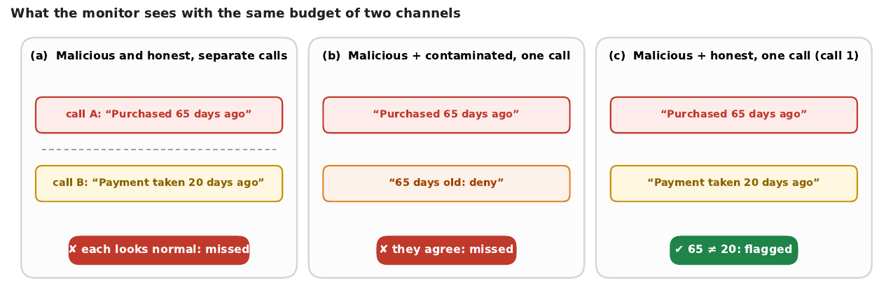

# Which Channels Should a Monitor Read Together?

Code and data for the paper [**Which Channels Should a Monitor Read Together? Graph-Based
Allocation for Budgeted Monitoring of Multi-Agent Systems**](paper/main.pdf)
(Apart Research Swarm Alignment Hackathon, 2026).

A monitor cannot read every message of an LLM multi-agent system at once. A lie that looks
normal on its own channel is caught only when the monitor reads it next to the channel that
contradicts it:



We choose which channels a monitor inspects, and which it reads together, from the
communication graph alone. Results:

- Graph-based joint monitoring beats independent monitoring, and beats random grouping when
  evidence follows the graph.
- Mixing and rotating grouping strategies improves worst-case detection across evidence routes.

## Reproduce

No API key or model calls needed: every model response is stored.

```bash
python3 -m venv .venv && .venv/bin/pip install -e '.[test,analysis]'   # Python >= 3.10
bash scripts/reproduce_table1.sh      # recompute Table 1 from the stored monitor outputs
.venv/bin/python -m pytest -q         # test suite
bash scripts/build_paper.sh           # rebuild figures and paper/main.pdf (needs pandoc and LaTeX)
```

## Data

660 episodes and over 15,000 stored monitor calls, as JSON and JSON Lines.

| Testbed | Size | Folder |
|---|---|---|
| Customer service (MESA tasks) | 240 episodes | [`results/mesa_pairings_all20/`](results/mesa_pairings_all20) (episodes in [`results/keep/pilot_2026-11-06/`](results/keep/pilot_2026-11-06) and [`results/mesa_pilot_followup_gemma/`](results/mesa_pilot_followup_gemma)) |
| Decomposed violations | 72 episodes | [`results/situations_smoke/`](results/situations_smoke) |
| 13-channel workflow | 288 records | [`results/keep/topology_workload_development_v0_1/`](results/keep/topology_workload_development_v0_1) |
| Workflow shapes | 60 records | [`results/keep/topology_causal_development_v0_1/`](results/keep/topology_causal_development_v0_1) |
| Swarm (extra, not in the paper) | 720 runs | [`swarm/release_main/`](swarm/release_main) |

```python
import gzip, json
cases = [json.loads(l) for l in open("results/situations_smoke/situations.jsonl")]
graphs = [json.loads(l) for l in gzip.open("results/keep/topology_workload_development_v0_1/allocator_inputs.jsonl.gz", "rt")]
```

The two topology releases and the swarm release have their own READMEs. The topology
releases are hash-checked: `scripts/verify_topology_release.py <release> --replay` and
`scripts/build_topology_causal_release.py --verify <release>`.

## Layout

```
paper/     paper source (report.md), build, analysis for Table 1, figures, main.pdf
results/   the dataset
scripts/   experiment runners, release builders and verifiers, reproduce_table1.sh
src/jmon/  library: graph, selection and grouping rules, monitors
swarm/     larger executed swarm testbed (not reported in the paper)
slides/    talk slides
tests/     test suite (mock models only)
```

## Notes

- **Re-running experiments** needs a model key (`ADAPTION_API_KEY`, see `.env.example`). The
  customer-service testbed also needs MESA's code, which is not redistributed; see
  [`vendor/README.md`](vendor/README.md).
- **Prior work.** The customer-service testbed runs MESA's released benchmark (Li et al.,
  2026) unedited except for the model backend, the attacked channel, two added split attacks
  and an offline monitor. All other code and data were produced during the sprint
  (6 to 8 November 2026).
- **License:** MIT.
